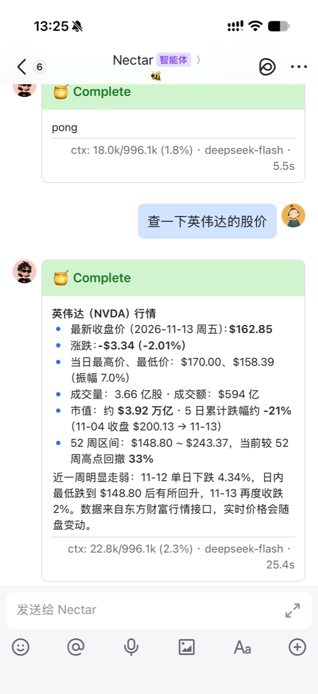
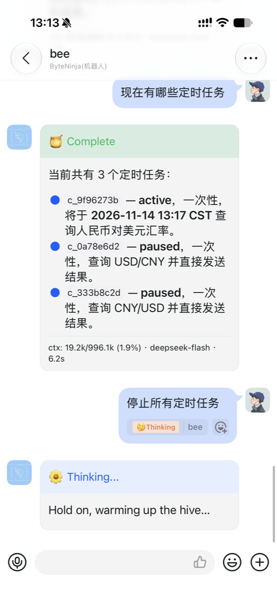
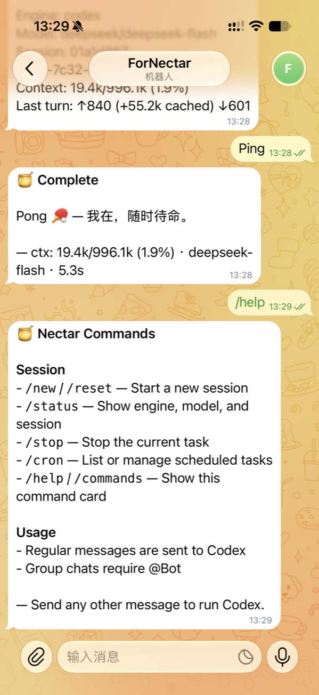

<h1 align="center">🍯 Nectar</h1>

<p align="center">
  <strong>Run multiple coding agents in the same repository — without stepping on each other.</strong><br>
  Use Codex, Claude Code, Cursor Agent, OpenCode, or Pi from Feishu / Lark, DingTalk, or Telegram. Per-session worktrees, reviewable memory, and steering for running tasks.
</p>

<p align="center">
  <a href="README.zh-CN.md">简体中文</a> ·
  <a href="README.md">English</a>
</p>

<p align="center">
  <a href="https://github.com/zhouyg1992/nectar/releases"></a>
  <a href="LICENSE"></a>
  
  
  <a href="https://github.com/zhouyg1992/nectar/actions/workflows/ci.yml"></a>
</p>

Nectar routes chat messages to coding agents on your machine and streams progress and results back. It does more than relay messages: it manages workspaces, memory, and running tasks, so several agents can work at once without colliding.

<p align="center">
  
</p>

## Screenshots

<table>
  <tr>
    <td align="center"><a href="docs/assets/screenshots/feishu.png"></a><br><sub><b>Feishu / Lark</b></sub></td>
    <td align="center"><a href="docs/assets/screenshots/dingtalk.png"></a><br><sub><b>DingTalk</b></sub></td>
    <td align="center"><a href="docs/assets/screenshots/telegram.png"></a><br><sub><b>Telegram</b></sub></td>
  </tr>
</table>

## Why Nectar

- **Parallel without collisions**: with `workspace_mode = "worktree"`, each session gets its own git worktree and branch; runs in the same workspace are serialized, different chats can run concurrently, and one process can host multiple isolated bots.
- **Reviewable memory**: failed runs create `pending` candidates that are injected only after approval; supports `bot` / `project` / `chat` scopes, dashboard bulk review, `nectar memory`, and the Agent Skill.
- **Steer a running task**: `/steer`, `/append`, `/ps`, and `/btw` add context to a running task; ordinary messages still queue; supported on Codex, Claude Code, Pi, and OpenCode.
- **Sessions that persist**: sessions live in the local data directory; `/list`, `/switch`, `/rename`, and `/archive` manage multiple sessions, and the service resumes a valid session after restart.
- **Chat is the interface**: Feishu / Lark, DingTalk, and Telegram, including direct messages, group chats, and Feishu thread replies.
- **Progress is visible**: 🌼 Thinking → 🐝 Working → 🍯 Complete / ⚠️ Failed, updated on the live card.
- **Tasks, files, and install**: cron, fixed intervals, and one-shot runs; inbound images and files go to the agent, files in `.nectar/outbox/` are sent back, and the installer detects engines and starts the service.

## Quick start

Requirements: macOS or Linux (Windows via WSL), `curl` or `wget`, `tar`, and one installed and logged-in engine.

### 1. Prepare one coding agent

Install and log in to **one** of: **Codex, Claude Code, Cursor Agent, OpenCode, or Pi**. The installer detects installed engines.

→ [Engine setup and login checks](docs/en/engines.md)

### 2. Install

Choose one of two paths.

**Option A — let your coding agent install it (recommended)**

Recommended if your agent can run terminal commands on this machine.

Paste this into Codex, Claude Code, Cursor Agent, OpenCode, or Pi:

> Install Nectar from <https://github.com/zhouyg1992/nectar>. Read AGENT_INSTALL.md in that repository and follow it. Ask me for credentials, and confirm before installing the background service.

Your agent reads the install contract, asks for the required credentials, runs the installer, and verifies the platform connection. See [AGENT_INSTALL.md](AGENT_INSTALL.md) for the full contract.

**Option B — install manually**

Before running it, create the platform app and get its credentials: [Feishu](docs/en/feishu.md) · [DingTalk](docs/en/dingtalk.md) · [Telegram](docs/en/telegram.md).

macOS / Linux (amd64 / arm64):

```bash
curl -fsSL https://raw.githubusercontent.com/zhouyg1992/nectar/main/install.sh | sh
```

The installer is interactive. Choose an engine and platform (Feishu / Lark by default), then enter the credentials. It writes `~/.nectar/config.toml`, installs the background service, and starts it.

> The installer starts the background service by default. You do not need to run `nectar` manually.

If you are not using the installer, write this minimal config to `~/.nectar/config.toml`:

```toml
[bot]
engine = "codex"
platform = "feishu"

[feishu]
app_id = "cli_your_app_id"
app_secret = "your_app_secret"
```

Everything else has built-in defaults. Make sure the `codex` CLI is installed and logged in. See the [configuration reference](docs/en/config.md) for details.

### 3. Verify

```bash
nectar service status
nectar service logs -f
```

If `nectar` is not found, run `~/.local/bin/nectar ...` or add `~/.local/bin` to `PATH`.

Send `/help` in chat first. Direct messages work without a mention; group messages require @Bot.

### Optional: harden access

The installer writes a minimal working config, but it does not restrict who can use the bot. Edit `~/.nectar/config.toml`:

```toml
[bot]
admin_users = ["ou_xxx"]
allowed_chats = ["oc_xxx"]
```

Then restart the service:

```bash
nectar service restart
```

The IDs above are Feishu examples: DingTalk uses `staffId` / `openConversationId`, and Telegram uses numeric user and chat IDs (quote negative group IDs). An empty `admin_users` leaves scheduled-task management open to anyone; an empty `allowed_chats` leaves group chats unrestricted. See the [configuration reference](docs/en/config.md) and [security boundaries](docs/en/security.md).

## Support matrix

**Platforms**

| Platform | Status | Setup |
|---|---|---|
| Feishu / Lark | ✅ Supported | [Feishu setup](docs/en/feishu.md) |
| DingTalk | ✅ Supported | [DingTalk setup](docs/en/dingtalk.md) |
| Telegram | ✅ Supported | [Telegram setup](docs/en/telegram.md) |
| WeChat, Slack | 🚧 Planned | [Roadmap](docs/en/roadmap.md) |

**Engines**

| Engine | Status | Invocation |
|---|---|---|
| Codex CLI | ✅ Supported | `exec --json` / `resume` |
| OpenCode | ✅ Supported | `run --format json` / `--session` |
| Cursor Agent CLI | ✅ Supported | `-p --output-format stream-json` / `--resume` |
| Claude Code | ✅ Supported | `-p --output-format stream-json` / `--resume` |
| Pi | ✅ Supported | `--mode json` / `--session` |
| Kimi | 🚧 Planned | See [Roadmap](docs/en/roadmap.md) |

## Commands

### CLI

```text
nectar [-config PATH]                 Run in the foreground
nectar -version                       Print the version
nectar help                           Show CLI help

nectar service install                Install and start the background service
nectar service start|stop|restart     Start / stop / restart
nectar service status                 Show status
nectar service logs                   Show logs
nectar service uninstall              Uninstall the service

nectar bots                           List configured bots
nectar worktrees list|remove          List or clean session worktrees
nectar update                         Update to the latest release
nectar schedule list|add|preview|pause|resume|run|cancel|delete|update
nectar skills install|uninstall       Manage agent skills
nectar memory add|search|list|get|approve|reject|pin|unpin|forget
nectar dashboard                      Print the local console login URL
nectar uninstall                      Uninstall Nectar
```

Aliases: `schedule ls` = `list`, `schedule stop` = `cancel`, `schedule del` / `rm` = `delete`, `skills remove` = `uninstall`. See the [command reference](docs/en/commands.md) for all flags.

### Chat commands

| Command | Purpose |
|---|---|
| `/new [name]`, `/reset` | Start a new session; previous sessions stay available |
| `/list [all] [limit]` | List sessions for this chat; default limit 50 |
| `/switch <id\|#\|name>` | Switch the active session |
| `/current` | Show the active session |
| `/rename <name>` | Rename the active session |
| `/archive [id]` | Archive a session |
| `/unarchive <id\|name>` | Restore an archived session |
| `/status` | Show the current engine, model, and session |
| `/stop` | Cancel the current run |
| `/steer`, `/append`, `/ps`, `/btw` | Insert text into a running turn (requires a persistent engine backend) |
| `/cron`, `/schedule` | Scheduled task entry point |
| `/help`, `/commands` | Show the command card without invoking the engine |

`/cron` subcommands:

```text
/cron list [all]
/cron add <min> <hour> <day> <month> <weekday> <prompt>
/cron every <duration> <prompt>
/cron in <duration> <prompt>
/cron at <RFC3339-time> <prompt>
/cron pause|resume|run|cancel|delete|update <id>
```

See [scheduled tasks](docs/en/schedule.md) for details, or send `/cron help` in chat. Scheduled tasks are enabled by default; no `[schedule]` section is required. Only users in `bot.admin_users` can manage them; an empty list removes that restriction. See [hardening access](#optional-harden-access).

In group chats, session management and steering commands are limited to `bot.admin_users`. Direct messages keep the single-user behavior.

## Maintenance

```bash
nectar update              # keep config and data, replace the binary, restart the service
nectar uninstall           # remove the service, binary, skills, and managed AGENTS.md blocks
nectar uninstall --purge-data
```

See [Install and upgrade](docs/en/install.md) for all update and uninstall flags.

## Docs

- [Engine setup and login checks](docs/en/engines.md)
- [Configuration reference](docs/en/config.md)
- [Install and upgrade](docs/en/install.md)
- [Command reference](docs/en/commands.md)
- [Feishu setup and troubleshooting](docs/en/feishu.md)
- [DingTalk setup and troubleshooting](docs/en/dingtalk.md)
- [Telegram setup and troubleshooting](docs/en/telegram.md)
- [Background service](docs/en/service.md)
- [Scheduled tasks](docs/en/schedule.md)
- [Security boundaries](docs/en/security.md)
- [Roadmap](docs/en/roadmap.md)
- [Changelog](docs/en/changelog.md)
- [中文文档](docs/zh-CN/README.md)

## License

MIT © 2026 zhou.yongguo. See [LICENSE](LICENSE).
