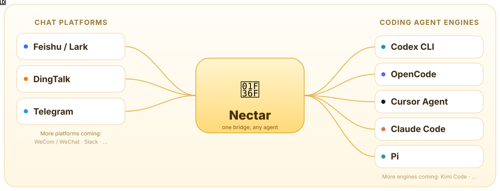

<h1 align="center">🍯 Nectar</h1>

<p align="center">
  <strong>Memory that grows with you.</strong><br>
  A Go bridge between chat apps and coding agents.
</p>

<p align="center">
  <a href="README.zh-CN.md">简体中文</a> ·
  <a href="README.md">English</a>
</p>

<p align="center">
  <a href="https://github.com/zhouyg1992/nectar/releases"></a>
  <a href="LICENSE"></a>
  
  
  <a href="https://github.com/zhouyg1992/nectar/actions/workflows/ci.yml"></a>
</p>

Nectar forwards Feishu or DingTalk messages to Codex CLI, OpenCode, Cursor Agent, Claude Code, or Pi and streams the result back as an interactive card. v1 supports Feishu / Lark and DingTalk with any of these engines.

<p align="center">
  
</p>

## Support matrix

**v1 supports Feishu / Lark and DingTalk with Codex CLI, OpenCode, Cursor Agent, Claude Code, or Pi.**

Legend: ✅ supported · 🚧 planned

### Platforms

| Platform | Status | Configuration | Notes |
|---|---|---|---|
| Feishu / Lark | ✅ Supported | [Feishu setup](docs/en/feishu.md) | WebSocket + @Bot<br>Cards: 🌼 Thinking → 🐝 Working → 🍯 Complete / ⚠️ Failed<br>Footer: context usage, model, time, tokens |
| DingTalk | ✅ Supported | [DingTalk setup](docs/en/dingtalk.md) | Stream mode + @Bot<br>A2UI streaming cards<br>No public callback or card template |
| Telegram | 🚧 Planned | — | Long polling |
| WeCom / WeChat | 🚧 Planned | — | Platform-dependent |
| Slack | 🚧 Planned | — | Socket Mode |
| More platforms | 🚧 Planned | — | Implement `PlatformAdapter` |

### Engines

| Engine | Status | Notes |
|---|---|---|
| Codex CLI | ✅ Supported | `exec --json` / `resume` |
| OpenCode | ✅ Supported | `run --format json` / `--session` |
| Cursor Agent CLI | ✅ Supported | `-p --output-format stream-json` / `--resume` |
| Claude Code | ✅ Supported | `-p --output-format stream-json` / `--resume` |
| Pi | ✅ Supported | `--mode json` / `--session` |
| Kimi Code | 🚧 Planned | Local server API adapter |
| More engines | 🚧 Planned | Implement `EngineAdapter` |

> Planned items indicate direction, not a schedule. See the [Roadmap](docs/en/roadmap.md) and Releases for progress.

## Install

macOS / Linux (amd64 / arm64):

```bash
curl -fsSL https://raw.githubusercontent.com/zhouyg1992/nectar/main/install.sh | sh
```

The installer is interactive. It:

- detects installed engine CLIs (`codex`, `opencode`, `agent` / `cursor-agent`, `claude`, `pi`) and exits if none are found
- lets you choose an engine and platform (Feishu / Lark by default, DingTalk optional)
- writes a minimal `~/.nectar/config.toml`
- installs the `nectar-schedule` skill for Codex / Claude / shared Agents roots and adds a managed `AGENTS.md` hint to the workspace
- installs and starts the background service by default

If `~/.nectar/config.toml` already exists, it is kept by default.

Pin a version or choose an install directory:

```bash
curl -fsSL https://raw.githubusercontent.com/zhouyg1992/nectar/main/install.sh | sh -s -- --version v0.5.3
curl -fsSL https://raw.githubusercontent.com/zhouyg1992/nectar/main/install.sh | sh -s -- --dir /usr/local/bin
```

Review the installer before running it:

```bash
curl -fsSL https://raw.githubusercontent.com/zhouyg1992/nectar/main/install.sh -o install.sh
sh install.sh
```

The installer verifies the SHA-256 checksum and installs to `~/.local/bin/nectar`.

Windows: use WSL or download a release manually. The repository must be public for anonymous `curl | sh`.

For non-interactive installs, pass the engine, platform, and credentials explicitly:

```bash
curl -fsSL https://raw.githubusercontent.com/zhouyg1992/nectar/main/install.sh |
  FEISHU_APP_ID=cli_xxx FEISHU_APP_SECRET=xxx sh -s -- --engine codex --platform feishu
```

For DingTalk, use `--platform dingtalk` with `DINGTALK_CLIENT_ID` / `DINGTALK_CLIENT_SECRET`.

Use `--no-service` to install the binary only, `--reconfigure` to back up and replace an existing config, and `--config PATH` to use a custom config path. On Linux, add `--linger` to start at boot without a login session.

To update an existing install, keep the current config and data, and restart the background service:

```bash
nectar update
```

Use `nectar update --check` to check the latest release without installing it. `--version vX.Y.Z` pins or downgrades, `--force` reinstalls the current version, `--no-restart` updates the binary and agent skill without touching the service, and `--no-skills` skips the skill refresh.

Session mappings and the last context usage are persisted in `~/.nectar/sessions.json`, so restarting the service during an update resumes the same engine thread. If an old engine session can no longer be resumed, Nectar warns in the final card and starts a new session.

To uninstall:

```bash
nectar uninstall                    # service, binary, skills, and managed AGENTS.md blocks
nectar uninstall --purge-data       # also removes config, task data, workspaces, and backups
nectar skills uninstall             # remove only the agent skill
```

`nectar uninstall` keeps config and task data by default. Use `--keep-binary` to keep
the executable, `--no-skills` to leave agent skills untouched, and `--dry-run` to
preview cleanup. If you used `--dir` or `--config`, pass `--binary` or `--config`
with the same paths.

> Background service support requires v0.1.1 or later.

## Prerequisites

Install and log in to **one** of the following engines. You do not need all of them; the installer only requires one.

### Codex CLI

Install Codex CLI and log in:

```bash
codex exec --json --skip-git-repo-check "reply with OK"
```

### OpenCode

Install OpenCode, configure a provider/model, and confirm it works:

```bash
opencode run --format json "Reply with exactly OK"
```

### Cursor Agent CLI

Install Cursor Agent CLI:

```bash
curl https://cursor.com/install -fsS | bash
```

The official installer provides both `agent` (primary) and `cursor-agent` (legacy alias). Nectar and the installer prefer `agent` and fall back to `cursor-agent`, so no symlink is needed.

Make sure `~/.local/bin` is in `PATH`, then verify:

```bash
agent login
agent -p --trust --mode ask "Reply with exactly OK"
```

### Claude Code CLI

Install Claude Code CLI and log in:

```bash
claude auth login
claude -p --permission-mode plan "Reply with exactly OK"
```

### Pi

Install Pi and log in:

```bash
pi auth check --provider anthropic
pi --mode json "Reply with exactly OK"
```

## Configuration

Edit `~/.nectar/config.toml`:

```toml
[feishu]
app_id = "cli_xxx"
app_secret = "xxx"
log_level = "info"

[codex]
path = "codex"
model = ""
effort = ""
sandbox = "workspace-write"
working_dir = "~/.nectar/workspace"
timeout = "30m"
max_output_bytes = 2097152
context_window = 0
per_chat_workspace = false
bypass_approvals = false

[opencode]
path = "opencode"
model = ""                    # e.g. provider/model#variant
agent = ""                    # optional OpenCode agent
working_dir = "~/.nectar/workspace"
timeout = "30m"
max_output_bytes = 2097152
context_window = 0            # 0 = auto-detect from OpenCode config
standalone = true             # private server per run
auto_approve = true           # required for non-interactive bot use
per_chat_workspace = false

[cursor]
path = "agent"
model = ""                    # e.g. composer-2.5; empty = Cursor default
mode = ""                     # plan | ask; empty = normal agent mode
sandbox = ""                  # enabled | disabled; empty = Cursor default
working_dir = "~/.nectar/workspace"
timeout = "30m"
max_output_bytes = 2097152
context_window = 0            # 0 = unknown; footer omits context percentage
auto_approve = true           # -f; required for non-interactive bot use
trust_workspace = true        # --trust; required for headless runs
per_chat_workspace = false

[claude]
path = "claude"
model = ""                    # e.g. claude-sonnet-4-5; empty = Claude Code default
fallback_model = ""           # optional fallback model
permission_mode = ""          # acceptEdits | plan | bypassPermissions | manual | dontAsk | auto
working_dir = "~/.nectar/workspace"
timeout = "30m"
max_output_bytes = 2097152
context_window = 0            # 0 = read context_window from the result event
max_turns = 0                 # 0 = no limit
auto_approve = true           # --dangerously-skip-permissions
per_chat_workspace = false

[pi]
path = "pi"
provider = ""                 # optional provider override
model = ""                    # e.g. claude-sonnet-4-5; empty = Pi default
thinking = ""                 # off | minimal | low | medium | high | xhigh | max
working_dir = "~/.nectar/workspace"
timeout = "30m"
max_output_bytes = 2097152
context_window = 0            # 0 = unknown; footer omits context percentage
trust_workspace = true        # --approve; load project-local Pi resources
per_chat_workspace = false

[bot]
name = "Nectar"
engine = "codex"              # codex | opencode | cursor | claude | pi
admin_users = []
allowed_chats = []

[storage]
data_dir = "~/.nectar"
```

`context_window = 0` auto-detects the model context window from the Codex model catalog. Set it explicitly if needed, e.g. `context_window = 258000`.

The footer model name uses `codex.model` when set, otherwise the model from Codex's config. The last path segment is displayed, e.g. `deepseek/deepseek-flash` becomes `deepseek-flash`.

For OpenCode, set `bot.engine = "opencode"`; Nectar uses `[opencode]`, resolves the model from `~/.config/opencode/opencode.json` when unset, and reads the last assistant turn's token usage from `opencode session export`. The context window is read from the model's `limit.context`; set `opencode.context_window` to override it when the model is not declared in OpenCode's config.

For Cursor, set `bot.engine = "cursor"`; Nectar runs the Cursor CLI (`agent`, falling back to `cursor-agent`) with `-p --output-format stream-json --stream-partial-output` and resumes sessions with `--resume`. `auto_approve` maps to `-f`, and `trust_workspace` maps to `--trust`; both are required for unattended bot use. Attachments are referenced by local path in the prompt. Set `cursor.context_window` explicitly if you want the context percentage in the footer.

For Claude Code, set `bot.engine = "claude"`; Nectar runs `claude -p --output-format stream-json --verbose --include-partial-messages`, passes the prompt on stdin, and resumes sessions with `--resume`. `auto_approve` maps to `--dangerously-skip-permissions`; when it is off, `permission_mode` is passed through. Token usage and the context window are read from the final `result` event, so `claude.context_window` is only needed as an override. Attachments are referenced by local path in the prompt.

For Pi, set `bot.engine = "pi"`; Nectar runs `pi --mode json`, passes the prompt on stdin, and resumes sessions with `--session`. `provider`, `model`, and `thinking` map directly to Pi flags. `trust_workspace` maps to `--approve`, which lets Pi load project-local settings, skills, context files, and extensions. Token usage is read from assistant message events; set `pi.context_window` if you want the context percentage in the footer. Attachments are referenced by local path in the prompt.

Environment overrides:

```bash
export FEISHU_APP_ID=cli_xxx
export FEISHU_APP_SECRET=xxx
export CODEX_PATH=codex
export OPENCODE_PATH=opencode
export CURSOR_AGENT_PATH=agent
export CLAUDE_PATH=claude
export PI_PATH=pi
export NECTAR_ENGINE=codex
export NECTAR_DATA_DIR=~/.nectar
export NECTAR_WORKING_DIR=~/.nectar/workspace
```

## Usage

```bash
nectar
```

If `~/.local/bin` is not on `PATH`, add it as printed by the installer.

Wait for:

```text
feishu websocket connected; ready to receive messages
```

Send `/help` first to verify the Feishu path without invoking the engine. Direct messages work without a mention; group messages require @Bot.

`/help`, `/commands`, and short questions like “what commands are available” return a command card without invoking the engine.

All built-in command results (`/new`, `/status`, `/stop`, and command errors) use platform cards; platforms without card support fall back to text.

During an agent run, intermediate agent messages update the `🐝 Working...` card in real time (throttled). The final `🍯 Complete` card contains only the last agent answer, not the intermediate narration.

> Help/command cards and real-time progress require v0.1.2 or later.

Topic messages are answered inside the same topic. Normal chat messages are still sent without quoting.

> Topic replies require v0.1.3 or later.

### Background service

After editing `~/.nectar/config.toml`:

```bash
nectar service install
```

- macOS: installs a LaunchAgent; starts at login and restarts after crashes
- Linux: installs a systemd user service; add `--linger` to start at boot without login
- `--no-start` installs and enables the service without starting it immediately
- Manage with `nectar service status|logs|restart|stop|uninstall`

Service mode reads the selected platform's credentials from the config file, not from shell environment variables. See [service management](docs/en/service.md) for details.

### Commands

| Command | Description |
|---|---|
| `/new`, `/reset` | Start a new agent thread |
| `/status` | Show the current engine, model, and agent thread ID |
| `/stop` | Cancel the current run |
| `/cron` | List, create, pause, resume, run, cancel, or delete scheduled tasks |
| `/help`, `/commands` | Show the command card without invoking the engine |

## Docs

- [English docs](docs/en/README.md)
- [Chinese docs](docs/zh-CN/README.md)
- [Service management](docs/en/service.md)
- [Scheduled tasks](docs/en/schedule.md)
- [Security](docs/en/security.md)
- [Roadmap](docs/en/roadmap.md)
- [Changelog](docs/en/changelog.md)

## License

MIT © 2026 zhou.yongguo. See [LICENSE](LICENSE).
