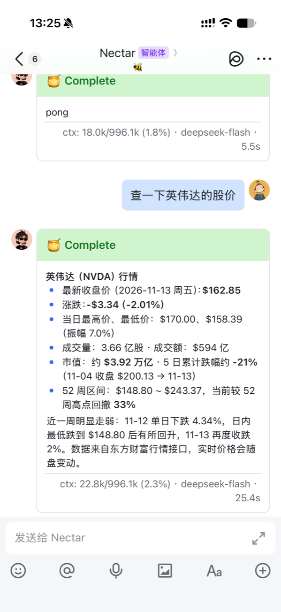
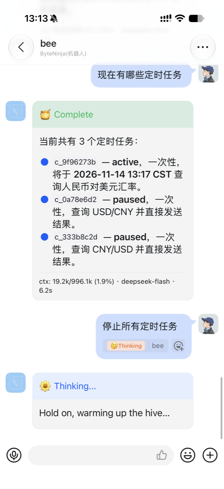
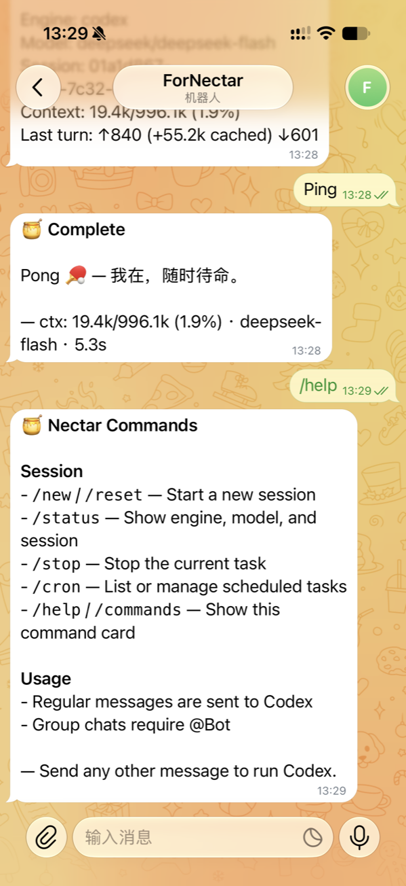

<h1 align="center">🍯 Nectar</h1>

<p align="center">
  <strong>一条消息，唤起你的编程 Agent。</strong><br>
  在飞书 / 钉钉 / Telegram 里直接使用 Codex、Claude Code、Cursor Agent、OpenCode 或 Pi。
</p>

<p align="center">
  <a href="README.zh-CN.md">简体中文</a> ·
  <a href="README.md">English</a>
</p>

<p align="center">
  <a href="https://github.com/zhouyg1992/nectar/releases"></a>
  <a href="LICENSE"></a>
  
  
  <a href="https://github.com/zhouyg1992/nectar/actions/workflows/ci.yml"></a>
</p>

Nectar 把聊天消息交给本机的编程 Agent 执行，再把过程和结果以实时消息或卡片回传。会话保持连续，进度实时可见，任务可以定时执行；安装器会检测本机引擎、写入配置并启动后台服务。

<p align="center">
  
</p>

## 界面预览

<table>
  <tr>
    <td align="center"><a href="docs/assets/screenshots/feishu.png"></a><br><sub><b>飞书 / Lark</b></sub></td>
    <td align="center"><a href="docs/assets/screenshots/dingtalk.png"></a><br><sub><b>钉钉</b></sub></td>
    <td align="center"><a href="docs/assets/screenshots/telegram.png"></a><br><sub><b>Telegram</b></sub></td>
  </tr>
</table>

## 为什么是 Nectar

- **聊天就是入口**：在飞书 / 钉钉 / Telegram 里直接对话，单聊和群聊都支持。
- **会话不断**：会话映射持久化到 `~/.nectar/sessions.json`，服务重启后，如果原会话仍然有效，就继续使用它。
- **进度看得见**：🌼 Thinking → 🐝 Working → 🍯 Complete / ⚠️ Failed，执行过程实时更新。
- **任务可以定时**：支持 cron、固定间隔和一次性任务，聊天与 CLI 都能管理。
- **记忆可携带**：本地优先的 profile / project / chat 记忆，支持审核、检索注入和 Agent CLI 读写。
- **引擎和平台可换**：Codex、Claude Code、Cursor Agent、OpenCode、Pi 按需选择。

## 快速开始

环境要求：macOS 或 Linux（Windows 用 WSL）、`curl` 或 `wget`、`tar`，以及一个已安装并登录的引擎。

### 1. 准备一个编程 Agent

任选其一，安装并完成登录：**Codex、Claude Code、Cursor Agent、OpenCode 或 Pi**。安装器会检测本机已安装的引擎。

→ [各引擎安装与登录验证](docs/zh-CN/engines.md)

### 2. 安装

任选一种方式即可。

**方式 A —— 让编程 Agent 安装（推荐）**

如果你的 Agent 可以在这台机器上执行终端命令，推荐使用这种方式。

把下面这段话发给你正在使用的 Codex、Claude Code、Cursor Agent、OpenCode 或 Pi：

> 帮我安装这个 bot：<https://github.com/zhouyg1992/nectar>。请阅读仓库根目录的 AGENT_INSTALL.md 并按其步骤执行；需要凭证时先问我，安装后台服务前也先确认。

Agent 会读取安装契约、向你索取所需凭证、执行安装，并验证平台连接。完整步骤见 [AGENT_INSTALL.md](AGENT_INSTALL.md)。

**方式 B —— 手动安装**

运行前请先创建平台应用并获取凭证：[飞书](docs/zh-CN/feishu.md) · [钉钉](docs/zh-CN/dingtalk.md) · [Telegram](docs/zh-CN/telegram.md)。

macOS / Linux（amd64 / arm64）：

```bash
curl -fsSL https://raw.githubusercontent.com/zhouyg1992/nectar/main/install.sh | sh
```

安装器是交互式的：选择引擎和平台（默认飞书 / Lark），填写对应凭证；随后写入 `~/.nectar/config.toml`，安装并启动后台服务。

> 安装脚本默认会启动后台服务，不需要再手动运行 `nectar`。

### 3. 验证

```bash
nectar service status
nectar service logs -f
```

如果提示找不到 `nectar`，请运行 `~/.local/bin/nectar ...`，或把 `~/.local/bin` 加入 `PATH`。

在聊天里先发送 `/help`。单聊直接发消息，群聊需要 @Bot。

### 可选：安全加固

安装器会写入最小可用配置，但不会自动限制使用者。建议编辑 `~/.nectar/config.toml`：

```toml
[bot]
admin_users = ["ou_xxx"]
allowed_chats = ["oc_xxx"]
```

然后重启服务：

```bash
nectar service restart
```

上面的 ID 是飞书示例：钉钉使用 `staffId` / `openConversationId`，Telegram 使用数字 user ID 和 chat ID（负数群 ID 需要加引号）。`admin_users` 为空时，任何人都能管理定时任务；`allowed_chats` 为空时，不限制群聊。完整配置见 [配置参考](docs/zh-CN/config.md) 和 [安全边界](docs/zh-CN/security.md)。

## 支持矩阵

**平台**

| 平台 | 状态 | 配置 |
|---|---|---|
| 飞书 / Lark | ✅ 已支持 | [飞书配置](docs/zh-CN/feishu.md) |
| 钉钉 | ✅ 已支持 | [钉钉配置](docs/zh-CN/dingtalk.md) |
| Telegram | ✅ 已支持 | [Telegram 配置](docs/zh-CN/telegram.md) |
| 微信、Slack | 🚧 计划中 | [Roadmap](docs/zh-CN/roadmap.md) |

**引擎**

| 引擎 | 状态 | 调用方式 |
|---|---|---|
| Codex CLI | ✅ 已支持 | `exec --json` / `resume` |
| OpenCode | ✅ 已支持 | `run --format json` / `--session` |
| Cursor Agent CLI | ✅ 已支持 | `-p --output-format stream-json` / `--resume` |
| Claude Code | ✅ 已支持 | `-p --output-format stream-json` / `--resume` |
| Pi | ✅ 已支持 | `--mode json` / `--session` |
| Kimi | 🚧 计划中 | 见 [Roadmap](docs/zh-CN/roadmap.md) |

## 命令

### CLI

```text
nectar [-config PATH]                 前台运行
nectar -version                       查看版本
nectar help                           查看 CLI 帮助

nectar service install                安装并启动后台服务
nectar service start|stop|restart     启动 / 停止 / 重启
nectar service status                 查看状态
nectar service logs                   查看日志
nectar service uninstall              卸载服务

nectar update                         升级到最新版本
nectar schedule list|add|preview|pause|resume|run|cancel|delete|update
nectar skills install|uninstall       Agent Skill 管理
nectar memory add|search|list|get|approve|reject|pin|unpin|forget
nectar uninstall                      卸载 Nectar
```

别名：`schedule ls` = `list`，`schedule stop` = `cancel`，`schedule del` / `rm` = `delete`，`skills remove` = `uninstall`。完整参数见 [命令参考](docs/zh-CN/commands.md)。

### 聊天命令

| 命令 | 作用 |
|---|---|
| `/new`、`/reset` | 新建会话 |
| `/status` | 查看当前引擎、模型和 Agent thread ID |
| `/stop` | 中断当前任务 |
| `/cron`、`/schedule` | 定时任务入口 |
| `/help`、`/commands` | 显示命令卡片，不调用引擎 |

`/cron` 子命令：

```text
/cron list [all]
/cron add <min> <hour> <day> <month> <weekday> <prompt>
/cron every <duration> <prompt>
/cron in <duration> <prompt>
/cron at <RFC3339-time> <prompt>
/cron pause|resume|run|cancel|delete|update <id>
```

详见[定时任务](docs/zh-CN/schedule.md)，或在聊天里发送 `/cron help`。定时任务默认开启，无需在配置里添加 `[schedule]`。管理命令仅限 `bot.admin_users`；该列表为空时不限制管理员。参见[安全加固](#可选安全加固)。

## 维护

```bash
nectar update              # 保留配置和数据，替换二进制并重启服务
nectar uninstall           # 删除服务、二进制、Skill 和 AGENTS.md 托管片段
nectar uninstall --purge-data
```

更新和卸载的完整参数见 [安装与升级](docs/zh-CN/install.md)。

## 文档

- [各引擎安装与登录验证](docs/zh-CN/engines.md)
- [配置参考](docs/zh-CN/config.md)
- [安装与升级](docs/zh-CN/install.md)
- [命令参考](docs/zh-CN/commands.md)
- [飞书配置与排查](docs/zh-CN/feishu.md)
- [钉钉配置与排查](docs/zh-CN/dingtalk.md)
- [Telegram 配置与排查](docs/zh-CN/telegram.md)
- [后台服务](docs/zh-CN/service.md)
- [定时任务](docs/zh-CN/schedule.md)
- [安全边界](docs/zh-CN/security.md)
- [路线图](docs/zh-CN/roadmap.md)
- [Changelog](docs/zh-CN/changelog.md)
- [English docs](docs/en/README.md)

## License

MIT © 2026 zhou.yongguo，详见 [LICENSE](LICENSE)。
