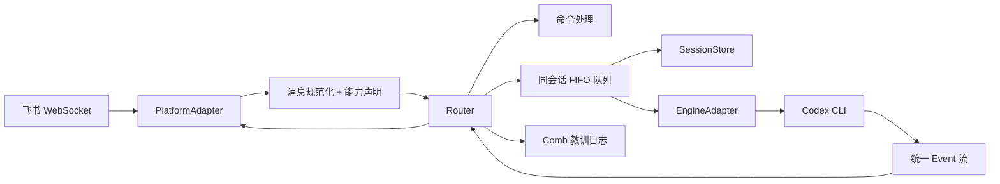

# 架构与扩展点

## 总览

## 分层

### Platform

- 位置：`internal/platform`
- 负责接收平台消息、发送文本/卡片、下载媒体。
- 通过 `Capabilities()` 声明是否支持卡片、流式更新、媒体和群聊。
- v1 实现：飞书。占位：Telegram。

### Core

- 位置：`internal/core`
- `Router`：命令处理、消息路由、Agent 执行、卡片生命周期。
- `/help`、`/commands`、短命令问句以及所有内置命令结果在 Router 本地处理，直接返回平台卡片，不进入引擎。
- `SessionStore`：三元组会话键 `(channel, chatID, agentID) → engine session ID`。
- `Queue`：同一会话 FIFO 串行，不同会话并发。
- 卡片流程：先发 `🐝 Thinking...`，工具调用时更新 `🐝 Working...`，结束时 PATCH 为 `🍯 Complete` 或 `⚠️ Failed`。

### Engine

- 位置：`internal/engine`
- 统一 `Event` 流：会话开始、文本、工具调用/结果、完成、错误。
- v1 实现：Codex CLI。
- 占位：Claude Code、Kimi、OpenCode、Pi。

### Exec

- 位置：`internal/exec`
- 工作目录解析、每会话子目录、输出限制和超时辅助。

### Service

- 位置：`internal/service`
- 管理 macOS LaunchAgent 和 Linux systemd user service。
- 服务文件只包含二进制路径、配置路径、HOME/PATH，不写入飞书凭证。
- 入口：`nectar service install|status|logs|restart|stop|uninstall`。

### Memory

- `internal/memory/comb`：教训日志。v1 只记录 `pending`，不注入。
- `internal/memory/pollen`：云同步接口，v1 不实现。

## 关键设计

### 飞书 dispatcher

`channel.NewChannel` 只有在底层 `wsClient` 已经带有 `EventDispatcher` 时才会注册消息处理器。飞书 adapter 创建 `wsClient` 时必须传入 `larkws.WithEventHandler(...)`，否则长连接能成功但消息会被静默丢弃。

### 会话隔离

会话键故意设计成三元组，v1 的 `agentID` 固定为 `codex`。后续增加多引擎时，同一个群可以同时拥有 `codex`、`claude` 等独立会话，不需要迁移存储结构。

### 卡片更新

卡片是飞书 `interactive` 消息：

1. 发送初始 Thinking 卡片，拿到 `message_id`。
2. 工具调用和中间 `agent_message` 按 2 秒节流 PATCH 整张卡片，实时显示执行过程。
3. Agent 完成后 PATCH 为最终状态；最终内容只使用最后一条非 commentary 消息（优先 `final_answer` phase）。
4. 如果 PATCH 失败，降级为发送新的最终卡片。

飞书卡片正文使用 `markdown` 组件，而不是 `div + lark_md`，以支持反引号行内代码和代码块。

### 上下文与模型

- `codex.context_window > 0` 时直接使用。
- 否则读取 `$CODEX_HOME/config.toml` 的 `model` / `model_catalog_json`，从模型目录读取 `context_window`。
- 页脚模型名优先使用 `codex.model`，为空时读取 Codex 自身配置，显示时取最后一段。

## 扩展点

- 新平台：实现 `platform.PlatformAdapter`。
- 新引擎：实现 `engine.EngineAdapter`。
- 定时任务：`internal/core/cron.go`。
- Jev 决策：`internal/core/decision`。
- 云同步：`internal/memory/pollen`。

开发与测试说明见 [development.md](development.md)。
