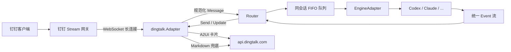

# 钉钉平台接入设计

## 1. 背景与目标

Nectar 目前只接入了飞书。本文设计钉钉平台适配器，目标是在不改变现有 Router、Engine 和会话模型的前提下，让钉钉具备与飞书接近的体验。

### 1.1 目标

- 使用钉钉 Stream 模式接收消息，不暴露公网端口，不配置回调地址。
- 支持流式卡片：Agent 执行过程中持续更新同一张卡片，完成后更新为最终状态。
- 支持钉钉富文本入站消息，包括文字、图文混排、图片和文件。
- 钉钉侧尽量少配置：只需要创建企业内部应用、启用机器人、选择 Stream 模式并授权；nectar 只要求提供 `client_id` 和 `client_secret`。
- Markdown 正常渲染：标题、列表、引用、行内代码、代码块、链接等常用语法不能退化成纯文本。
- 无卡片权限或卡片接口不可用时，自动降级为普通 Markdown 消息，机器人仍然可用。

### 1.2 非目标

- 不实现钉钉群机器人 Webhook 模式。
- 不要求用户创建卡片模板，也不把 `card_template_id` 作为默认配置项。
- 不实现卡片按钮、表单、审批等交互能力。
- 不实现多平台同时在线；第一版仍由 `bot.platform` 选择一个平台。
- 不实现音频、视频和合并转发消息的完整处理。

## 2. 方案结论

| 需求 | 方案 |
|---|---|
| 不走公网回调 | 钉钉 Stream 模式，WebSocket 长连接 |
| 流式卡片 | 钉钉 A2UI JSON 卡片，`createAndDeliver` + `update` |
| 不配置卡片模板 | A2UI 由代码直接描述卡片结构，不需要 `cardTemplateId` |
| 富文本入站 | 解析 `text`、`richText`、`image/picture`、`file` |
| Markdown 渲染 | 卡片内使用 A2UI `Markdown` 组件 |
| 最小配置 | 只填 `client_id` / `client_secret`，`robot_code` 默认等于 `client_id` |
| 卡片不可用 | 自动降级为 `sampleMarkdown` 消息 |

选择 A2UI 而不是传统 AI 卡片模板，是本文最关键的决策。传统 AI 卡片要求先在钉钉卡片平台创建模板并拿到 `cardTemplateId`，与“只配置机器人 + AppKey/AppSecret”的目标冲突；A2UI 允许在请求里直接发送 `createSurface`、`updateDataModel`、`updateComponents`，因此可以做到零模板配置。

需要注意：A2UI 是较新的接口，部分组织可能尚未开通。设计上必须保留 Markdown 降级路径，不能把卡片当作唯一发送方式。

## 3. 总体架构



关键点：

- 进程只主动连接钉钉，不监听端口，不需要域名、HTTPS 证书或反向代理。
- 入站消息统一转换为 `platform.Message`，Router 不感知钉钉协议。
- 卡片更新复用现有 `PlatformAdapter.Update(ctx, messageID, Reply)`，`messageID` 对应 A2UI 的 `outTrackId`。
- 钉钉适配器负责协议、鉴权、重连、降级和附件下载。

## 4. 钉钉侧最小配置

### 4.1 控制台步骤

1. 在钉钉开放平台创建「企业内部应用」。
2. 在「应用功能」中启用「机器人」。
3. 机器人消息接收模式选择「Stream 模式」。
4. 在「权限管理」申请消息收发、文件下载和 AI 卡片相关权限。
5. 发布应用版本，并把使用者加入可用范围。

不需要：

- 配置公网回调地址。
- 配置域名或 HTTPS 证书。
- 在卡片平台创建卡片模板。

### 4.2 权限

以开放平台实际展示为准，通常需要：

| 用途 | 权限 | 是否必需 |
|---|---|---|
| 接收机器人消息 | 机器人消息订阅 / Stream 事件 | 是 |
| 发送机器人消息 | 机器人消息发送 | 是 |
| 流式卡片 | `AICard.Instance.Write` | 流式卡片需要；缺失时自动降级 Markdown |
| 下载图片/文件 | 机器人消息文件下载 | 使用附件功能时必需 |
| 表情回复 | 机器人表情回复 | 可选 |

如果只授予消息收发权限，nectar 仍然可以工作，只是所有回复都会走普通 Markdown。

卡片权限属于钉钉控制台的一次性授权，不是 nectar 的配置项；nectar 侧仍然只需要 `client_id` 和 `client_secret`。

### 4.3 nectar 配置

```toml
[bot]
platform = "dingtalk"
engine = "codex"
admin_users = []       # 可选：钉钉 staffId 列表
allowed_chats = []     # 可选：钉钉 openConversationId 列表

[dingtalk]
client_id = "dingxxxxxxxxxxxxxxxx"
client_secret = "xxxxxxxxxxxxxxxxxxxxxxxxxxxxxxxx"

# 以下均可省略
# robot_code = "dingxxxxxxxxxxxxxxxx"  # 默认等于 client_id
# log_level = "info"
# card_enabled = true                  # 默认 true；false 时只用 Markdown
```

兼容旧叫法：

- `client_id` 等价于钉钉旧版 `AppKey`。
- `client_secret` 等价于钉钉旧版 `AppSecret`。
- 如果用户更习惯 `app_key` / `app_secret`，配置层可以同时接受这两组字段，归一化后使用。
- 可选支持 `DINGTALK_CLIENT_ID` / `DINGTALK_CLIENT_SECRET` 环境变量；后台服务仍以配置文件为准。

### 4.4 平台选择

为保持向后兼容，`main.go` 按以下顺序选择平台：

1. `bot.platform` 非空时使用该值。
2. 未配置时，如果只有 `[dingtalk]` 有凭证，自动使用钉钉。
3. 未配置时，如果只有 `[feishu]` 有凭证，自动使用飞书。
4. 两边都有凭证且未指定平台时，启动失败并提示设置 `bot.platform`。

## 5. 详细设计

### 5.1 包结构

```text
internal/platform/dingtalk/
├── adapter.go        # Start/Send/Update/Download、能力声明
├── stream.go         # Stream 连接、重连、原始回调解析
├── message.go        # text/richText/image/file 归一化
├── reply.go          # sessionWebhook 与主动发送
├── card.go           # A2UI 卡片创建、更新、节流、降级
├── markdown.go       # A2UI Markdown 与 sampleMarkdown 适配
├── media.go          # downloadCode 下载、文件名处理
└── *_test.go
```

### 5.2 启动与连接

使用 `github.com/open-dingtalk/dingtalk-stream-sdk-go`：

```go
streamClient := dingtalkClient.NewStreamClient(
    dingtalkClient.WithAppCredential(
        dingtalkClient.NewAppCredentialConfig(cfg.ClientID, cfg.ClientSecret),
    ),
)
```

注册原始回调路由，而不是只注册 SDK 的类型化机器人回调：

```go
streamClient.RegisterRouter(
    utils.SubscriptionTypeKCallback,
    payload.BotMessageCallbackTopic,
    func(ctx context.Context, df *payload.DataFrame) (*payload.DataFrameResponse, error) {
        adapter.enqueueRaw(df.Data)
        return payload.NewSuccessDataFrameResponse(), nil
    },
)
```

原因：SDK 的类型化模型会丢掉 `text.isReplyMsg`、`text.repliedMsg` 等字段，导致“引用回复”内容不可见。原始 JSON 解析可以保留这些信息。

连接管理：

- `Start(ctx, handler)` 在后台 goroutine 中运行 `streamClient.Start(ctx)`。
- 外层使用重连循环，断开后等待 3 秒再重连。
- 每次重连都 recover panic，避免单次异常导致机器人永久失联。
- `Start` 阻塞到 `ctx.Done()`，然后取消 Stream 客户端并返回。
- 回调只负责入队，不在 SDK 回调里执行 Agent 或发送消息，保证 ACK 及时返回。

入队通道使用有界 buffer（建议 128）。队列满时记录错误并丢弃当前消息，避免回调线程被阻塞。

### 5.3 入站消息与富文本

#### 消息归一化

| 钉钉 `msgtype` | 处理方式 |
|---|---|
| `text` | 读取 `text.content` |
| `richText` | 按顺序拼接文字，图片位置替换为 `[Image N]` 并生成附件 |
| `image` / `picture` | 生成一个图片附件，文本为空 |
| `file` | 生成一个文件附件，保留 `fileName` |
| `audio` | 可选；优先使用 `recognition` 文本，同时下载音频 |
| 其他 | 记录日志并忽略 |

`richText` 的典型结构：

```json
{
  "richText": [
    {"text": "看下这张图"},
    {"text": " ", "downloadCode": "xxx"},
    {"text": "然后修复"}
  ]
}
```

处理规则：

- 按数组顺序遍历，保持文字和图片的相对位置。
- 每个 `downloadCode` 生成 `attachment.Resource{Kind: KindImage, Key: downloadCode, Name: "image-N.png"}`。
- 兼容旧字段：`downloadCode` 为空时回退到 `pictureDownloadCode`。
- 文本中插入 `[Image N]`，与飞书 `post` 的处理保持一致。
- 如果文本为空但有图片，Router 会使用默认附件提示词。

#### 引用回复

从原始 JSON 中解析：

```go
type richTextEnvelope struct {
    IsReplyMsg bool            `json:"isReplyMsg"`
    RepliedMsg *repliedMessage `json:"repliedMsg"`
}
```

如果 `isReplyMsg` 为 true，把被引用内容拼到用户文本前面：

```text
[引用消息]
> 被引用的内容

用户本轮输入
```

被引用内容截断到 4000 个 rune。被引用的是互动卡片时，从 `repliedMsg.content` 中递归提取 `content`、`text`、`title`、`markdown` 等字段，深度限制 4 层，避免大对象进入 prompt。

#### 去重与防回放

- 按 `msgId` 去重，TTL 60 秒。
- `createAt` 早于进程启动时间 2 秒以上的消息直接丢弃。
- 这两个机制用于处理 Stream 重连、ACK 丢失和进程重启后的历史消息重放。

#### 白名单

- `bot.admin_users` 匹配钉钉 `senderStaffId`。
- `bot.allowed_chats` 匹配 `conversationId`（即 `openConversationId`）。
- 两个列表都为空时允许所有可达用户，但启动日志必须打印安全警告。
- 外部联系人的 `senderStaffId` 可能为空；白名单非空时按未授权处理。

#### 群聊 @

- `Capabilities.MentionOnly = true`。
- 如果回调包含 `isInAtList` 且为 false，直接忽略。
- 如果群消息文本带有 `@机器人` 前缀，按机器人名称或 `robotCode` 剥离；联调时用真实群消息确认是否需要额外处理。

### 5.4 会话与回复上下文

#### 核心改动

在 `internal/platform/platform.go` 的 `Message` 和 `Reply` 中增加一个不透明字段：

```go
type Message struct {
    // ...
    ReplyContext any
}

type Reply struct {
    // ...
    ReplyContext any
}
```

`internal/core/router.go` 的 `replyTarget` 需要把这个字段原样带到 `Reply`：

```go
func replyTarget(msg platform.Message) platform.Reply {
    reply := platform.Reply{
        ChatID:       msg.ChatID,
        ReplyContext: msg.ReplyContext,
    }
    // ...
    return reply
}
```

钉钉适配器定义自己的私有结构：

```go
type replyContext struct {
    sessionWebhook            string
    sessionWebhookExpiredTime int64
    conversationID            string
    senderStaffID             string
    messageID                 string
    isGroup                   bool
    robotCode                 string
}
```

不把 `sessionWebhook` 编码进 `ChatID` 或 `ThreadID`。`ChatID` 参与会话键和 workspace 路径，塞入平台私有数据会污染会话隔离，也会让 `/new`、`/status` 和每会话工作目录出现不可预期的行为。

#### 会话键

- `ChatID = conversationId`。
- `UserID = senderStaffId`。
- `ChatType = "p2p"` 或 `"group"`。
- `ThreadID = ""`，钉钉没有飞书话题概念。

群聊默认共享一个会话，和 nectar 飞书群聊行为一致。如果以后需要群内按用户隔离，可以在 `SessionKey` 中增加独立的 `UserScope` 字段，而不是修改 `ChatID`。

### 5.5 文本与 Markdown 回复

#### 发送通道

优先使用入站消息自带的 `sessionWebhook`：

```json
{
  "msgtype": "markdown",
  "markdown": {
    "title": "🍯 Complete",
    "text": "最终回复内容"
  }
}
```

以下情况改用 OpenAPI 主动发送：

- `sessionWebhook` 为空。
- `sessionWebhookExpiredTime > 0` 且距离过期不足 30 秒。
- 当前回复上下文来自 cron 或 ReconstructReplyCtx，没有 webhook。

群聊：

```json
{
  "robotCode": "dingxxxx",
  "openConversationId": "cidxxxx",
  "msgKey": "sampleMarkdown",
  "msgParam": "{\"text\":\"最终回复内容\"}"
}
```

单聊：

```json
{
  "robotCode": "dingxxxx",
  "userIds": ["staffId"],
  "msgKey": "sampleMarkdown",
  "msgParam": "{\"title\":\"🍯 Complete\",\"text\":\"最终回复内容\"}"
}
```

注意：`msgParam` 必须是 JSON 字符串，不是 JSON 对象。这是钉钉 API 的常见坑。

#### 发送结果校验

- Webhook：响应必须包含 `errcode` 且为 0。
- 主动发送：必须包含非空 `processQueryKey`，且 `invalidStaffIdList`、`flowControlledStaffIdList` 为空。
- 网络超时或响应无法解析时返回“投递结果未知”，不自动重试，避免重复消息。

#### `sampleMarkdown` 适配

钉钉 IM Markdown 不是标准 Markdown 渲染器，需要做轻量预处理：

- 行首空格转换为不换行空格，避免缩进被吞。
- 非空行之间的单换行补两个空格，强制换行。
- 代码块内部不做处理。
- 从内容首行提取短标题，最多 20 个 rune。
- 内容为空或只有 Markdown 符号时，标题回退为 `reply`。

这部分与 cc-connect 的实现保持一致。

#### A2UI Markdown 适配

卡片内的 `Markdown` 组件支持标题、列表、代码和引用，不需要 `sampleMarkdown` 的 NBSP/双空格 hack。需要额外处理：

- 统一换行为 `\n`。
- 保证 fenced code block 成对出现；截断时补上代码围栏的结束标记。
- 转义原始 HTML，避免 agent 输出中的 `<div>` 等标签被意外解释；后续支持 @ 时只放行 `<a atId="...">`。
- GFM 表格由 `parseCardBlocks` 从 Markdown 中拆出，转换为 A2UI `Table` 组件；
  原始表格文本写入组件的 `fallbackMarkdown`，旧客户端无法渲染时仍可显示。
- 超长内容按字节截断，落在 UTF-8 边界，并追加 `…（内容过长，已截断）`。

渲染矩阵：

| Markdown 语法 | 处理方式 |
|---|---|
| 标题、列表、引用 | A2UI `Markdown` 原生渲染 |
| 行内代码、代码块 | 原生渲染；截断时自动闭合代码块 |
| 粗体、斜体、链接 | 原生渲染 |
| 表格 | 解析为 A2UI `Table` 组件，`fallbackMarkdown` 保留原始表格 |
| 图片 | 保留 Markdown 图片语法；P1 解析为 A2UI `Image` 组件 |
| 原始 HTML | 默认转义；后续只放行 @ 提及标签 |

### 5.6 流式卡片

#### 与飞书卡片的关系

两条链路在 Router 看来完全一致：

```text
Send(Thinking 卡片) -> 拿到 messageID -> 多次 Update -> 最终 Update(Complete/Error)
```

差异只在适配器内部：

| 能力 | 飞书 | 钉钉 |
|---|---|---|
| 初始卡片 | `interactive` 消息 | A2UI `createAndDeliver` |
| 更新句柄 | 飞书 `message_id` | A2UI `outTrackId` |
| 更新接口 | 消息 PATCH | `PUT /v1.0/card/ai/instances/update` |
| 流式状态 | 卡片内容更新 | `flowStatus=INPUTTING` |
| 结束状态 | 卡片更新为完成/失败 | `flowStatus=FINISH/ERROR` |
| 节流 | Router 2 秒 | Router 2 秒 + 适配器 single-flight |

因此不需要为钉钉修改 Router 的卡片生命周期，只需要实现新的 `PlatformAdapter`。

#### 为什么 A2UI

传统 AI 卡片：

```text
卡片平台创建模板 → 拿到 cardTemplateId → createAndDeliver → streaming 更新
```

A2UI：

```text
代码生成卡片结构 → createAndDeliver → update
```

A2UI 不需要模板，适合 nectar“只配置机器人”的目标。

#### 卡片结构

第一版卡片保持简单，使用一个根 `Column` 和三个子组件：

```text
root Column
├── header CardHeader   title  = /title
├── body   Markdown     content = /content
└── footer Text         text    = /footer
```

组件示例：

```json
[
  {
    "id": "root",
    "component": "Column",
    "children": ["header", "body", "footer"],
    "gap": 8
  },
  {
    "id": "header",
    "component": "CardHeader",
    "title": {"path": "/title"},
    "theme": "blue"
  },
  {
    "id": "body",
    "component": "Markdown",
    "content": {"path": "/content"}
  },
  {
    "id": "footer",
    "component": "Text",
    "variant": "caption",
    "text": {"path": "/footer"}
  }
]
```

数据模型：

```json
{
  "title": "🐝 Working...",
  "content": "正在执行：`ls -la`",
  "footer": "codex · 12s · 3.2k/258k"
}
```

#### 创建卡片

`POST https://api.dingtalk.com/v1.0/card/ai/instances/createAndDeliver`

```json
{
  "outTrackId": "nectar-1730000000000-a1b2c3d4",
  "openSpaceId": "dtv1.card//im_group.cidxxxx",
  "protocolVersion": "1.0",
  "flowStatus": "PROCESSING",
  "a2uiMessages": [
    "{\"version\":\"v1.0\",\"createSurface\":{\"surfaceId\":\"nectar-main\",\"catalogId\":\"https://dingtalk.com/card/a2ui/catalogs/public/catalog.json\"}}",
    "{\"version\":\"v1.0\",\"updateDataModel\":{\"surfaceId\":\"nectar-main\",\"path\":\"/\",\"value\":{\"title\":\"🐝 Working...\",\"content\":\"正在思考，请稍候…\",\"footer\":\"codex\"}}}",
    "{\"version\":\"v1.0\",\"updateComponents\":{\"surfaceId\":\"nectar-main\",\"components\":[{\"id\":\"root\",\"component\":\"Column\",\"children\":[\"header\",\"body\",\"footer\"],\"gap\":8},{\"id\":\"header\",\"component\":\"CardHeader\",\"title\":{\"path\":\"/title\"},\"theme\":\"blue\"},{\"id\":\"body\",\"component\":\"Markdown\",\"content\":{\"path\":\"/content\"}},{\"id\":\"footer\",\"component\":\"Text\",\"variant\":\"caption\",\"text\":{\"path\":\"/footer\"}}]}}"
  ],
  "a2uiAnnotations": [
    {"surfaceId": "nectar-main", "componentId": "header", "type": "artifact"},
    {"surfaceId": "nectar-main", "componentId": "body", "type": "artifact"}
  ],
  "summary": "Nectar 正在处理",
  "imGroupOpenSpaceModel": {
    "supportForward": true,
    "lastMessageI18n": {"ZH_CN": "Nectar 正在处理"}
  },
  "imGroupOpenDeliverModel": {
    "robotCode": "dingxxxx"
  }
}
```

说明：

- `a2uiMessages` 是 JSON 字符串数组，不是对象数组。
- `openSpaceId` 群聊使用小写 `im_group`，单聊使用小写 `im_robot`。
- `surfaceId` 每张卡片独立；首版直接复用 `outTrackId`，避免同一会话里多张卡片互相覆盖。
- 单聊投递时使用 `imRobotOpenSpaceModel` 和 `imRobotOpenDeliverModel`，不能同时传群聊模型。
- `callbackType` 不传表示卡片无交互回调；以后加按钮时传 `"STREAM"`，不需要 `callbackRouteKey`。
- `a2uiAnnotations` 标记标题和正文，使卡片完成后会话中能显示最终内容摘要。
- `summary` 是纯文本降级摘要，建议不超过 2048 字节。

单聊的 `openSpaceId`：

```text
dtv1.card//im_robot.<senderStaffId>
```

单聊投递模型：

```json
{
  "imRobotOpenDeliverModel": {
    "robotCode": "dingxxxx",
    "recipients": ["<senderStaffId>"]
  }
}
```

联调时优先验证 `recipients` 字段；如果当前租户接口要求 `userId` 或 `openConversationId`，在适配器内部做兼容，不把差异暴露给上层。

#### 更新卡片

`PUT https://api.dingtalk.com/v1.0/card/ai/instances/update`

```json
{
  "outTrackId": "nectar-1730000000000-a1b2c3d4",
  "outUpdateId": "nectar-1730000000000-a1b2c3d4-7",
  "flowStatus": "INPUTTING",
  "a2uiMessages": [
    "{\"version\":\"v1.0\",\"updateDataModel\":{\"surfaceId\":\"nectar-main\",\"path\":\"/content\",\"value\":\"正在执行：`go test ./...`\"}}",
    "{\"version\":\"v1.0\",\"updateDataModel\":{\"surfaceId\":\"nectar-main\",\"path\":\"/footer\",\"value\":\"codex · 18s\"}}"
  ]
}
```

最终更新：

```json
{
  "outTrackId": "nectar-1730000000000-a1b2c3d4",
  "outUpdateId": "nectar-1730000000000-a1b2c3d4-8",
  "flowStatus": "FINISH",
  "a2uiMessages": [
    "{\"version\":\"v1.0\",\"updateDataModel\":{\"surfaceId\":\"nectar-main\",\"path\":\"/title\",\"value\":\"🍯 Complete\"}}",
    "{\"version\":\"v1.0\",\"updateDataModel\":{\"surfaceId\":\"nectar-main\",\"path\":\"/content\",\"value\":\"最终回复\"}}",
    "{\"version\":\"v1.0\",\"updateDataModel\":{\"surfaceId\":\"nectar-main\",\"path\":\"/footer\",\"value\":\"codex · 32s · 4.1k/258k\"}}",
    "{\"version\":\"v1.0\",\"updateComponents\":{\"surfaceId\":\"nectar-main\",\"components\":[{\"id\":\"header\",\"component\":\"CardHeader\",\"title\":{\"path\":\"/title\"},\"theme\":\"green\"}]}}"
  ]
}
```

首版更新时直接发送完整组件树，避免不同客户端对 `updateComponents` 增量/全量语义理解不一致；后续如果需要减小 payload，再改成按组件 id 增量更新。

#### 状态映射

| `platform.CardStatus` | `flowStatus` | Header theme |
|---|---|---|
| `CardThinking` | `PROCESSING` / `INPUTTING` | `blue` |
| `CardInfo` | `FINISH` | `blue` |
| `CardComplete` | `FINISH` | `green` |
| `CardError` | `ERROR` | `red` |

映射规则：

- `Send` 收到 `CardThinking`：创建卡片，`flowStatus=PROCESSING`，返回 `outTrackId`。
- `Send` 收到 `CardInfo` / `CardComplete` / `CardError`：创建卡片并立即用最终状态收尾，用于 `/help`、`/new`、`/status` 等一次性卡片。
- `Update` 收到 `CardThinking`：`flowStatus=INPUTTING`。
- `Update` 收到 `CardComplete`：`flowStatus=FINISH`。
- `Update` 收到 `CardError`：`flowStatus=ERROR`。

#### 节流与并发

- Router 已有 `CardUpdateInterval`，默认 2 秒；适配器不修改这个值。
- 适配器内部按 `outTrackId` 维护一把互斥锁，同一张卡片同时最多有一个 update 请求。
- 如果标题、正文、页脚、主题和 `flowStatus` 都没有变化，跳过重复更新。
- 最终更新使用独立的状态值，确保 `FINISH` / `ERROR` 不会被中间进度覆盖。
- `outUpdateId` 使用 `outTrackId + "-" + 递增序号`；重试时复用同一个 ID，避免重复更新。

#### 卡片降级

以下情况把卡片标记为不可用，后续 `Capabilities()` 返回 `Card=false`、`Streaming=false`：

- HTTP 403 / `access.denied`。
- `AICard.Instance.Write` 权限缺失。
- `system.featureDisabled`。
- `param.openSpaceIdInvalid` 且确认不是单聊/群聊模型选择错误。
- 连续 429 / 5xx。

降级窗口建议 30 分钟。当前正在执行的轮次：

- 如果 `Send` 创建 `Thinking` 卡片失败，不发送额外的临时文本，避免留下无法更新或撤回的
  “Thinking” 消息；适配器改为在用户消息上贴 `🤔Thinking` 表情，Agent 完成后撤回。
- 一次性卡片或最终卡片创建失败时，仍然发送文本兜底，避免帮助内容或最终答案丢失。
- 如果 `Update` 失败，Router 的 `finish` 会尝试发送最终卡片；再次失败后发送普通文本。

钉钉适配器实现可选的 `platform.TypingIndicator` 接口。卡片不可用时，Router 调用
`StartTyping` 贴表情，Agent 结束后调用返回的 stop 函数撤回表情。如果表情权限也没有开通，
则只是没有即时提示，不会留下误导性的常驻消息。

`cardAvailable` 使用原子变量或读写锁保护，因为 `Capabilities()` 会被 Router 并发调用。

### 5.7 附件下载

入站附件使用 `attachment.Resource`：

```go
attachment.Resource{
    Kind:      attachment.KindImage,
    Key:       downloadCode,
    Name:      fileName,
    MessageID: msgID,
}
```

下载流程：

1. `POST https://api.dingtalk.com/v1.0/robot/messageFiles/download`

```json
{
  "downloadCode": "xxxx",
  "robotCode": "dingxxxx"
}
```

2. 响应返回 `downloadUrl`，使用 HTTP GET 下载。
3. 写入 `dir`，文件名使用 `filepath.Base` 清理，并加 `messageID` 前缀。
4. 返回 `attachment.Local{Kind, Path, Name, MimeType}`。

限制：

- 图片最大 25 MiB。
- 文件最大 50 MiB。
- 音频最大 25 MiB。
- 写入权限 `0600`。
- 如果响应没有 `Content-Type`，用 `http.DetectContentType` 推断。

### 5.8 错误处理与降级

- 所有 HTTP 请求使用 30 秒超时，并绑定调用方 `ctx`。
- 读取错误响应体最多 64 KiB，解析 `code`、`message`、`requestId` 后再包装错误。
- Access Token 使用互斥锁缓存，提前 5 分钟刷新；`expireIn` 缺失时按 7200 秒处理。
- 获取 Token 的请求体为 `{"appKey": client_id, "appSecret": client_secret}`。
- 网络超时、响应无法解析等“结果未知”场景不自动重试发送，避免重复消息。
- 卡片更新是幂等的：5xx 或超时可以用同一个 `outUpdateId` 重试一次；普通文本发送不做盲目重试。
- 卡片更新失败时，当前轮次仍必须保证用户能看到最终答案。
- 日志不打印消息正文、Access Token、`sessionWebhook` 完整 URL；只打印会话 ID、消息 ID、类型、附件数量和卡片 `outTrackId`。

### 5.9 安全与幂等

- 白名单在消息入队前检查，未授权消息不进入 Router。
- 群聊只处理 @ 机器人的消息。
- 附件文件名必须经过 `filepath.Base` 和前缀处理，禁止路径穿越。
- 卡片内容中的原始 HTML 默认转义；后续支持 @ 时只允许 `<a atId="...">`。
- `outTrackId` 每次新卡片重新生成，不复用；`outUpdateId` 在同一次更新重试时保持不变。
- 服务模式从配置文件读取凭证，不依赖 shell 环境变量。

## 6. 接口与数据结构

### 6.1 配置结构

```go
type DingTalkConfig struct {
    ClientID     string `toml:"client_id"`
    ClientSecret string `toml:"client_secret"`
    RobotCode    string `toml:"robot_code"`
    LogLevel     string `toml:"log_level"`
    CardEnabled  *bool  `toml:"card_enabled"`
}

type BotConfig struct {
    // ...
    Platform string `toml:"platform"`
}
```

归一化规则：

- `client_id` 为空时尝试 `app_key`。
- `client_secret` 为空时尝试 `app_secret`。
- `robot_code` 为空时使用 `client_id`。
- `log_level` 为空时使用 `info`。
- `card_enabled` 为空时视为 `true`。

### 6.2 适配器接口

```go
func New(cfg Config) (*Adapter, error)
func (a *Adapter) Name() string
func (a *Adapter) Capabilities() platform.Capabilities
func (a *Adapter) Start(ctx context.Context, handler func(platform.Message)) error
func (a *Adapter) Send(ctx context.Context, reply platform.Reply) (string, error)
func (a *Adapter) Update(ctx context.Context, messageID string, reply platform.Reply) error
func (a *Adapter) Download(ctx context.Context, resource attachment.Resource, dir string) (attachment.Local, error)
```

`Capabilities()` 返回：

```go
platform.Capabilities{
    Streaming:   cardAvailable,
    Card:        cardAvailable,
    Media:       true,
    Group:       true,
    MentionOnly: true,
}
```

钉钉另外实现可选的 `platform.TypingIndicator`，用于卡片不可用时在用户消息上贴表情。

### 6.3 钉钉 API 清单

| 用途 | 方法与路径 |
|---|---|
| 获取 Access Token | `POST /v1.0/oauth2/accessToken` |
| 创建并投递 A2UI 卡片 | `POST /v1.0/card/ai/instances/createAndDeliver` |
| 更新 A2UI 卡片 | `PUT /v1.0/card/ai/instances/update` |
| 下载消息文件 | `POST /v1.0/robot/messageFiles/download` |
| 群聊主动发送 | `POST /v1.0/robot/groupMessages/send` |
| 单聊主动发送 | `POST /v1.0/robot/oToMessages/batchSend` |
| 添加表情回复 | `POST /v1.0/robot/emotion/reply` |
| 撤回表情回复 | `POST /v1.0/robot/emotion/recall` |

## 7. 兼容性与迁移

- 飞书适配器不需要修改行为，只需忽略新增的 `ReplyContext` 字段。
- `bot.platform` 未配置时保持现有飞书行为。
- `nectar service install` 的配置校验需要按平台分支检查凭证；不能继续只检查 `[feishu]`。
- 现有 `docs/zh-CN/feishu.md` 不受影响；新增 `docs/zh-CN/dingtalk.md` 作为用户配置指南。
- 钉钉接入不改变 Router、SessionStore、Queue、EngineAdapter 的接口。

### 7.1 改造清单

| 文件 | 变更 |
|---|---|
| `internal/platform/platform.go` | `Message` / `Reply` 增加 `ReplyContext any` |
| `internal/core/router.go` | `replyTarget` 透传 `ReplyContext` |
| `internal/platform/dingtalk/` | 新增钉钉适配器、Stream、卡片、Markdown、附件实现 |
| `config/config.go` | 增加 `DingTalkConfig`、`Bot.Platform` 和归一化校验 |
| `config.example.toml` | 增加 `[dingtalk]` 示例和 `bot.platform` 说明 |
| `main.go` | 按 `bot.platform` 创建 Feishu / DingTalk 适配器 |
| `service_cli.go` | 服务安装时按所选平台校验凭证 |
| `docs/zh-CN/dingtalk.md` | 新增钉钉用户配置与排查指南 |
| `docs/zh-CN/README.md` | 增加设计文档和用户指南入口 |

## 8. 测试计划

### 8.1 单元测试

- `parseCallback`：text、richText、image、file、引用回复。
- `extractRichText`：文字和图片顺序、空内容、只有图片。
- `A2UI` 请求构造：创建、更新、最终状态、单聊/群聊 `openSpaceId`。
- Markdown 适配：代码块、引用、列表、表格解析、截断和代码块闭合。
- `sampleMarkdown`：行首空格、单换行、代码块不处理、标题提取。
- `shouldUseProactive`：webhook 为空、过期边界、cron 上下文。
- Access Token：缓存、并发刷新、`expireIn` 缺失。
- 去重：TTL、重复 `msgId`、空 `msgId`。
- 白名单：staffId、conversationId、空列表。

### 8.2 HTTP 测试

使用 `httptest.Server` 替换 `api.dingtalk.com`：

- Token 请求体和服务响应解析。
- Webhook 成功、`errcode != 0`、响应体无法解析。
- 主动发送群聊/单聊 payload，`msgParam` 必须是字符串。
- A2UI 创建/更新 payload，`a2uiMessages` 是字符串数组。
- 403、`system.featureDisabled` 触发降级。
- 更新超时返回“投递结果未知”，不重复发送。
- 附件下载 URL、大小限制、文件名清理。

### 8.3 手动联调

使用真实钉钉企业内部应用：

1. 单聊发送 `/help`，确认一次性卡片和 Markdown 降级都正常。
2. 发送普通问题，确认卡片从 `Working` 更新到 `Complete`。
3. 发送包含标题、列表、引用、行内代码、代码块和表格的回复，检查渲染。
4. 发送图片和文件，确认附件下载和 Agent 读取。
5. 群聊 @ 机器人，确认只处理 @ 消息，回复回到正确会话。
6. 断开网络再恢复，确认 Stream 自动重连。
7. 重启 nectar，确认旧消息不会被重复执行。
8. 临时撤销 `AICard.Instance.Write`，确认自动降级为 Markdown 且不阻塞回复。

### 8.4 CI

```bash
go test ./...
go test -race ./...
go vet ./...
go build ./...
sh -n install.sh
```

### 8.5 验收标准

| 需求 | 验收方式 |
|---|---|
| 最小配置 | 只填写 `client_id` / `client_secret`，启动后单聊发送 `/help` 能收到回复 |
| 不走公网回调 | 本机不监听任何 HTTP 端口，仍能正常收发消息 |
| 流式卡片 | 一次 Agent 执行中，同一 `outTrackId` 至少收到 2 次更新，最终状态为 `FINISH` |
| Markdown 渲染 | 标题、列表、引用、行内代码、代码块在钉钉客户端正常显示 |
| 富文本入站 | 图文混排消息的文字和图片都能被 Agent 看到 |
| 卡片降级 | 撤销 AI 卡片权限后，机器人仍能用普通 Markdown 回复 |
| 防回放 | 重启 nectar 后，重启前的历史消息不会再次触发 Agent |

## 9. 实施里程碑

MVP 以 M1 + M2 为准：M1 单独可用，但只有 M2 完成后才满足“流式卡片”的完整需求。

### M1：最小可用链路

- 配置结构、`bot.platform`、`main.go` 平台选择。
- Stream 连接、重连、原始回调解析。
- text / richText / image / file 入站。
- sessionWebhook + 主动发送 Markdown。
- 去重、防回放、白名单。
- 附件下载。

### M2：流式卡片

- A2UI 卡片创建和更新。
- 状态映射、节流、最终收尾。
- Markdown 适配和截断。
- GFM 表格解析为 A2UI `Table` 组件。
- 卡片不可用时的 `🤔Thinking` 表情提示与撤回。
- 卡片降级和 `Capabilities()` 动态切换。
- 单元测试和 HTTP 测试。

### M3：体验补齐

- 群聊 @ 体验优化。
- 出站图片/文件。
- 卡片按钮和 Stream 卡片回调（可选）。

## 10. 风险与待验证

| 风险 | 影响 | 应对 |
|---|---|---|
| A2UI 在部分组织未开通 | 卡片创建失败 | 自动降级 Markdown，30 分钟后重试 |
| 单聊 `im_robot` 投递字段与文档示例不完全一致 | 单聊卡片无法发送 | 适配器内部兼容 `recipients` / `userId`，联调确认 |
| 旧版钉钉客户端不支持部分 A2UI 组件 | 卡片局部显示异常 | 给关键组件设置 `fallbackMarkdown`，并保留普通 Markdown 兜底 |
| 旧客户端不支持 A2UI `Table` | 表格显示异常 | `Table` 组件设置 `fallbackMarkdown`，保留原始表格文本 |
| 卡片完成后会话列表预览不刷新 | 预览停留在“处理中” | 可选发送一条最终预览消息；默认不发送，避免噪音 |
| 钉钉群 @ 文本可能带机器人前缀 | 命令匹配失败 | 按 `robotCode` / 机器人名称剥离，联调确认 |
| Access Token 或卡片接口限流 | 卡片更新变慢 | 节流、single-flight、指数退避；最终消息必须送达 |
| 多实例同时运行 | 消息被其他实例处理 | 文档明确只保留一个实例；后续可增加实例锁 |

## 11. 参考

- 钉钉 Stream 模式：<https://open.dingtalk.com/document/development/introduction-to-stream-mode>
- 机器人发送 A2UI 卡片：<https://open.dingtalk.com/document/development/robot-send-aicard>
- 机器人更新 A2UI 卡片：<https://open.dingtalk.com/document/development/robot-update-aicard>
- 创建并投放 AI 卡片：<https://open.dingtalk.com/document/development/api-createanddeliveraicard>
- 更新 AI 卡片：<https://open.dingtalk.com/document/development/api-updateaicard>
- A2UI Markdown 组件：<https://open.dingtalk.com/document/development/json-card-basic-components>
- 参考实现：`chenhg5/cc-connect` 仓库中的 `platform/dingtalk/dingtalk.go`、`platform/dingtalk/card.go`、`docs/dingtalk.md`（MIT License）
